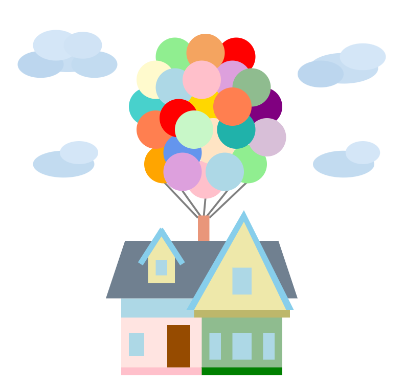
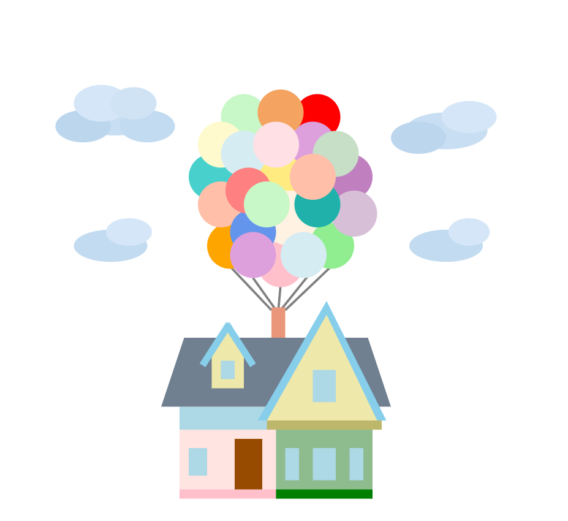

# Anna Towne - A1

I have made an image recreating the house from the movie Up using the design primitives. Additionally when you hover over the balloons they turn a little bit of a lighter color and holds that way for 1 second.

### Normal

### After Partially Moused Over

You can open this webpage using:
- https://atowne-802.github.io/a1-atowne-802-Anna-Towne/

Or run it locally with:
- python -m http.server
- http://localhost:8000

## Design Achievements
I believe I adequately met the design achievements by using my creative freedom to make a picture rather than just doing one or two with each shape. Clouds layered from several ellipses with shading, the 24 balloons placed by hand, and the house built from rectangles and polygons. All placement was done by hand. 

## Technical Achievements
I also used ellipses (more than the 4 main primitives), and I implemented an interactive event so when the user hovers over the balloons they shift to a lighter color and a delay makes them stay that for 1 second after the mouse is moved. 

## Resources
To accomplish this I used a couple websites to both know the colors I was working with, and know general documentation of how to make these primitives in js.
1) https://austingil.com/every-css-named-color-organized-by-palette/
2) https://www.tutorialsteacher.com/d3js/create-svg-elements-in-d3js
3) https://developer.mozilla.org/en-US/docs/Web/SVG/Tutorials/SVG_from_scratch/Basic_shapes
4) https://using-d3js.com/08_01_events.html